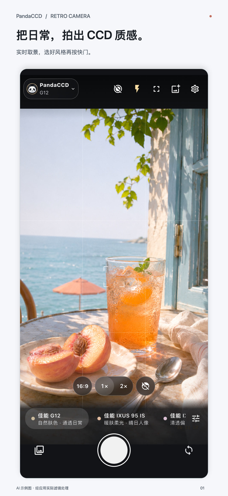

# PandaCCD

一款在设备本地处理照片与视频的复古 CCD 相机，支持 Android 和 iOS。

核心滤镜与美颜使用 Flutter / Dart / GLSL，实现实时预览、原创 HALD LUT、可调多人美颜、Live 动态照片、照片编辑、日期水印和本地相册。无需账号，不上传照片或人脸数据。

当前源码版本：**0.14.9（build 48）**。

## 开源与隐私

本仓库源码采用 [MIT License](LICENSE)。第三方源码、算法和素材的许可证见 [依赖与参考来源](docs/THIRD_PARTY.md) 及 `assets/licenses/`。品牌相关机型名称只用于说明风格灵感，不表示品牌合作或精确复刻。

公开仓库不包含签名证书、设备标识、私有 API 密钥、构建产物和真机隐私测试材料。`app-store/` 中的联系邮箱是用户确认用于商店支持的公开邮箱。

## 功能

- 多款原创 CCD 风格预设与自定义 HALD LUT
- GPU 实时预览、可调颗粒、色偏、暗角和美颜
- 最多八张可识别人脸的美颜处理
- Android Motion Photo 与 Apple Live Photo
- 前后镜头、变焦、闪光灯、音量键快门
- 本地相册、二次编辑、批量管理和系统分享
- 横竖屏、折叠屏和多种画幅适配



以下为开发与版本说明。

当前版本为 0.14.9（build 48）。美颜支持最多八张可识别的人脸，取景、成片和 Live 共用多人美颜。系统相册同步失败或待确认时，可从照片详情重新同步。联动删除会保留尚未核实系统副本的照片。

iOS 进度、验证边界和本机安装入口见 [IOS_PORT_0130.md](docs/IOS_PORT_0130.md)。

安装包位于 `dist/panda-ccd-0.14.9-debug.apk`，校验值见 `dist/SHA256SUMS.txt`。手机可在夸克网盘的“来自：Codex / 熊猫 CCD 测试包”下载。

设备测试：`flutter test integration_test/camera_flow_test.dart -d <设备ID> --enable-impeller`。测试运行器结束后可能卸载应用，重跑时需要重新处理系统相机授权。该测试使用设备摄像头；示例图编辑测试另见 `integration_test/editor_flow_test.dart`。

复古 CCD 拍照应用，Flutter / Dart / GLSL，共用 Android、iOS 核心代码。石墨灰界面、银色熊猫镜头标志、原创 HALD LUT、实时 GPU 预览、照片编辑、像素日期戳和本地相册。

## 运行与构建

已使用 Flutter **3.47.8 / Dart 3.13.7** 开发验证。运行实时预览需 **Impeller**。Android 最低 API24；iOS 工程最低15.0。先安装 Flutter、Android SDK/JDK17/CMake 3.22.1 或完整 Xcode（本工程使用 Swift Package Manager）；运行 `flutter doctor -v` 确认工具链。

```sh
flutter pub get
flutter analyze
flutter test
flutter run -d <设备ID> --enable-impeller
flutter build apk --debug
flutter build ios --simulator --debug --no-codesign
```

发布时需自行配置 Android 正式签名、iOS Team/Bundle ID/签名。工程 Android release 当前使用 Flutter 默认调试签名，不能直接作为商店发布包。

本机开发工具位于 `~/.cache/panda-ccd/toolchains/`，不属于工程依赖；其他机器请安装相同版本。所有依赖版本由 `pubspec.lock` 锁定。

## 使用

1. 打开相机授予相机权限；底部点选机型或左右滑动取景器切换。点顶部机型名打开完整机型库，查看机型、年代和风格说明。点“调一调”调整预览参数。
2. 顶部可开启 Live，点按闪光灯在关闭、自动和开启之间切换。右下角的双箭头切换前后摄像头。按圆形快门后默认直接保存，留在取景页继续拍摄。
   在取景下方点倍率切换，点 1× 回到主摄。点已选倍率可打开滑杆，取景时也可双指缩放。可选倍率由设备能力决定。
3. 打开应用内相册，点照片右上角的铅笔图标进入“编辑照片”，可切换机型、调整滤镜和画幅，或旋转照片。
4. 日期戳和机型水印独立开关，红/黄、上下左右位置可选。保存后先进入作品库，再写系统相册；权限被拒不会丢失本地成片。
5. 底部左侧进入作品库，点图查看、缩放、再次编辑、存入系统相册、分享或删除；长按或点“选择”可多选、全选和批量删除。相册删除联动默认开启，可在设置关闭；旧作品先关联，权限不足时保留本地作品。分享按钮只打开系统面板，由你选择接收方。
6. 取景页可开启 LIVE。点美颜图标打开面板，可在面板内开关美颜并滑动调节各项参数。Live 声音、导出格式在设置中调整。动态部分后台生成，作品详情可播放与重新编辑。
7. 取景页画幅入口或设置可选择默认画幅，编辑照片时可单独修改。习惯先编辑的用户可在设置中开启“拍照后打开编辑”。设置还可调整快门声、音量键拍照和默认水印，保存参数、导出/导入预设 JSON、载入 HALD PNG、重置当前机型；关于页可查看版本、隐私和开源致谢。
8. 无摄像头或不支持实时滤镜时会显示状态，可从相册导入照片编辑。应用内标注的示例图为原创插画。

| 机型灵感 | 本应用风格方向 |
|---|---|
| 佳能G12 | 自然肤色、通透日常 |
| 佳能IXUS95 IS | 暖肤柔光、晴日人像 |
| 佳能IXUS130 | 清透偏粉、闪光人像取向 |
| 索尼W350 | 蓝绿清爽、街头风景 |
| 索尼W830 | 明亮柔和、轻盈日常 |
| 富士F200EXR | 浓郁蓝绿、VIVID模式灵感 |

| 创意风格 | 风格 |
|---|---|
| 竹影青 | 清透青绿、轻颗粒 |
| 落日罐头 | 暖色浓郁、高光溢出 |
| 蓝调散步 | 冷蓝偏品、柔暗部 |
| 桃气假日 | 暖肤色、低对比 |
| 像素日记 | 低清、抖动、颜色断层 |

以上是原创调优风格，不是商业相机品牌的精确色彩复刻。真实相机表现会随白平衡、曝光、闪光灯和场景改变，LUT也不能替代实际闪光灯照明。原有创意滤镜、照片ID和自定义参数继续保留，更新后不按新列表序号错配旧预设。

## 自定义 LUT 与工程说明

[架构、HALD格式和内存策略](docs/ARCHITECTURE.md) · [验收清单与实际验证边界](docs/ACCEPTANCE.md) · [依赖与参考来源](docs/THIRD_PARTY.md)

HALD 必须是正方形 PNG，边长为 `level³`，例如64×64（level4，16³颜色）、512×512（level8，64³颜色），R最快。`.cube` 和普通8×8分块PNG不能直接当HALD使用。详见架构文档。重新生成内置 LUT：

```sh
python3 tool/generate_luts.py
```

`lib/domain` 为模型，`lib/services` 为相机/滤镜/作品库与状态，`lib/ui` 为界面，`shaders/ccd.frag` 为全部滤镜公式。平台目录包含启动壳、权限及窗口设置；新增 `packages/panda_media` 双端桥负责本地人脸识别、媒体编解码与Apple Live配对，没有原生滤镜。美颜和瘦脸共用Dart/GLSL。相册、分享与握持感知使用跨平台社区插件 gal/share_plus/sensors_plus/audioplayers/vol_spotter/photo_manager，属于对“全部官方插件”要求的明确偏差。新增sensors_plus是因为官方camera在Android上不能独立提供锁定竖屏后的物理握持方向；两端共用Dart逻辑。audioplayers播放已随包注明CC0来源的快门实录；photo_manager提供保存资源ID及系统删除/查询，gal保留最小写入授权；vol_spotter提供物理音量键事件，Flutter通用键盘事件在安卓实测不能单独覆盖。iOS音量监听实现及验证边界见0.8.0说明。

CI 提供静态分析、测试、Android debug APK、iOS模拟器构建；本次未运行远端CI。物理相机实时渲染、60fps、双端系统权限和分享仍需真机验收，不能用单元测试代替。
