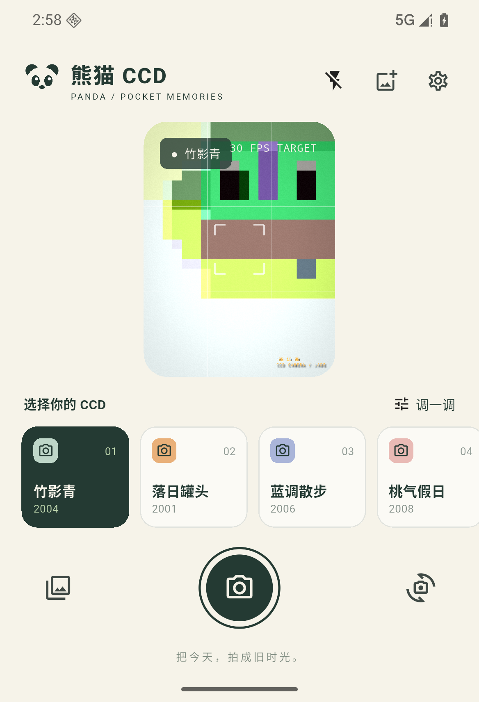
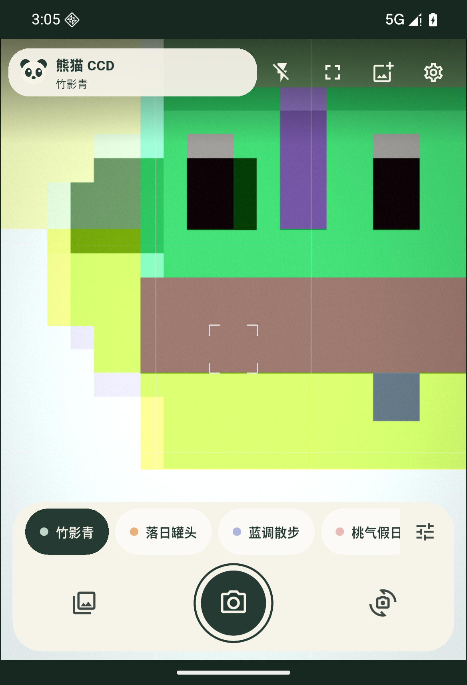

# 相机界面适配调研与改动

## 0.4.0：握持方向与横拍（2026-10-26）

补充反馈：手机侧过来后，界面仍然竖着。0.2.0的窗口布局只能响应系统已旋转的窗口；不能独立感知锁定竖屏后的握持变化。camera_android_camerax的DeviceOrientationManager依据界面配置和显示旋转产生方向事件，不能用这个事件独立解决该情况。

产品参考：[Apple Camera Control](https://developer.apple.com/design/human-interface-guidelines/camera-control)为横竖屏提供相应控件展示；[Halide水平仪说明](https://luxoptics.zendesk.com/hc/en-us/articles/360051909571-Level-Shots)覆盖横竖握持；[Android相机预览指南](https://developer.android.com/media/camera/camera2/camera-preview)区分传感器、设备与窗口方向。本次据此采用横向侧边操作区、完整画幅等比预览，拍摄方向单独传给相机，不拉伸图像。这些是本产品的设计取舍，并非对竞品布局的逐项复刻。

- 新增纯Dart握持方向服务，使用sensors_plus的重力加速度信号；稳定350ms才请求横竖屏，斜放、平放和明显晃动保持上一个方向。
- 调用Flutter SystemChrome请求相机界面方向，不修改用户的系统自动旋转设置。退到后台或销毁页面时恢复系统方向策略；编辑页继续跟随握持方向。
- 横屏沿用右侧机型/快门栏；暗房在较小横屏窗口也使用左右布局。
- 拍照通过官方camera的lockCaptureOrientation临时指定当前握持方向，拍完释放，避免界面旋转事件稍晚导致成片方向错误。
- 预览与导出共用的水印改为“熊猫CCD / 机型 INSPIRED”；日期、颜色、四角位置和独立开关保留。历史成片不重写。

边界：[Flutter方向接口说明](https://api.flutter.dev/flutter/services/SystemChrome/setPreferredOrientations.html)明确Android16、宽度至少600dp的显示屏可能忽略方向请求；iPad多任务也有限制。这些窗口继续按实际宽高布局。已测的是手机自然竖屏坐标体系；自然横屏平板、折叠展开姿态和iOS真实传感器行为仍待对应设备验证。没有读取铰链角度或实现折叠专用模式。

设备回归：Android36 ARM64模拟器，窗口1168×1712、420dpi，先设置系统accelerometer_rotation=0、user_rotation=0，然后使用模拟器加速度信号`0:9.81:0`、`9.81:0:0`、`-9.81:0:0`切换握持姿态。`integration_test/locked_rotation_test.dart`等待宿主按日志ROTATION_READY_LEFT/RIGHT/PORTRAIT依次输入信号，检查窗口随握持旋转、无布局异常，横拍不手动旋转直接保存1280×720成片，并检查转回竖屏。测试后系统旋转锁仍为0。不是通过修改窗口尺寸来代替物理方向验证。

实际截图：[横屏相机](screenshots/landscape-camera.png)、[横屏暗房](screenshots/landscape-editor.png)、[熊猫CCD水印成片](screenshots/panda-watermark-photo.png)。图像内容来自模拟器相机测试图，不作为滤镜审美或肤色效果验证。

## 0.2.0：短屏布局

日期：2026-10-26。

## 用户反馈与原因

用户提供的1168×1712截图是偏短、偏宽的竖屏窗口。旧版把品牌头部、大机型卡片、快门和标语依次放进Column，剩余高度才交给取景器。完整16:9竖向相机预览为保持比例，只能连同宽度一起缩小。小取景器还让两侧的预设名和开发帧率重叠。这是布局策略问题，不应按特定手机型号打补丁。

## 调研

| 产品/指南 | 已确认的做法 | 本次采用 |
|---|---|---|
| [Apple 相机工具](https://support.apple.com/en-euro/guide/iphone/iph3dc593597/27/ios/27) | 比例等工具可通过控制按钮或上滑展开，用后关闭 | 调参按需弹出，减少常驻控件 |
| [Samsung Flex mode](https://www.samsung.com/uk/mobile-phone-buying-guide/samsung-flex-mode/) | 半折状态把预览与操作重新分布到上下两半 | 根据可用空间重排操作区域；本期不是半折铰链模式的实现 |
| [Android 多形态相机指南](https://developer.android.com/develop/adaptive-apps/guides/camera-form-factors-support) | 按窗口适配；fit center或center crop，避免拉伸相机图像 | 完整画幅等比适配，控件作为浮层 |
| [Android 预览指南](https://developer.android.com/media/camera/camera2/camera-preview) | 折叠/窗口变化和物理旋转不必一致 | 预览方向跟随官方CameraPreview使用的相机方向，而非仅凭窗口宽高推测 |
| [iPhone Duo 开发说明](https://developer.apple.com/videos/play/tech-talks/111465/) | 新的双显示屏相机使用场景和前置相机选择 | 不维护手机型号白名单；两端共用窗口布局规则。未宣称已实现Duo的原生双屏/相机切换接口 |

## 实现

- 取景画面作为整块可用窗口的背景，取消居中圆角卡片外框和固定上下留白。
- 保留相机完整画幅，使用contain等比显示；不会因为屏幕变短而拉伸或悄悄裁切保存照片。比例不匹配时可能有深色边带。
- 顶部品牌缩为小标识，开发帧率文字移出产品界面；当前机型名称独立显示，不与其他文字重叠。
- 94px高的大机型卡片改为48px高的横向选择条，快门保持76px。选中机型变化时滚动到可见位置。
- 机型和快门采用浮层布局，不参加取景器高度分配。控件可能覆盖画面边缘；纯净取景可隐藏机型栏，快门/相册/切换镜头仍可用。
- 调参使用底部面板，取景器尺寸和构图保持不变；面板关闭后保存参数。
- 横向窗口宽度至少560dp且宽高比≥1.15，或宽度至少700dp且宽高比≥0.85时，采用侧栏；侧栏宽172/220dp，避免旧版固定330dp把横向画面再次挤小。
- 纯净模式在横屏也会收起侧栏。始终通过LayoutBuilder处理当前窗口，不识别型号、不修改原生滤镜。
- SafeArea避开状态栏和系统手势区，控件可滚动；不锁屏幕方向。

## 验证范围

自动化覆盖：完整16:9画面的比例与边界；424×622短屏、320×480、320×568、390×844长屏、844×390横屏、800×800近方形、980×700、600×400，以及短屏1.6倍字体。调参和纯净模式不会缩小取景区；快门保持可点。

424×622窗口中，16:9竖向完整画幅的几何宽度约350dp（窗口宽的82.5%），高度622dp；这是布局单元测试的几何结果，不是特定实机的测量值。实际可用高度还受系统安全区影响。

模拟器结果见本次验收记录。尚未在用户的小米折叠屏或iPhone Duo真机验证；不把普通窗口尺寸覆盖等同于厂商双屏、半折姿态或铰链适配。

## 本轮实测结果

- Android构建通过，静态分析无问题，7项测试通过。
- 1168×1712、420dpi的Android36 ARM64模拟器中，真实camera插件→GPU shader→参数面板→纯净取景→拍照→编辑旋转→保存设备测试通过。
- 日志未发现Flutter/AndroidRuntime错误。未修改滤镜公式与照片导出裁剪逻辑。
- 新包为 `dist/panda-ccd-0.2.0-debug.apk`；保留0.1.0便于回退。

| 同一模拟器窗口，改动前 | 改动后 |
|---|---|
|  |  |

纯净取景的实际截图：[隐藏机型栏](screenshots/short-screen-clean.png)。纯净模式仍保留拍摄、相册和切换镜头入口，点击顶部同一按钮恢复机型栏。
